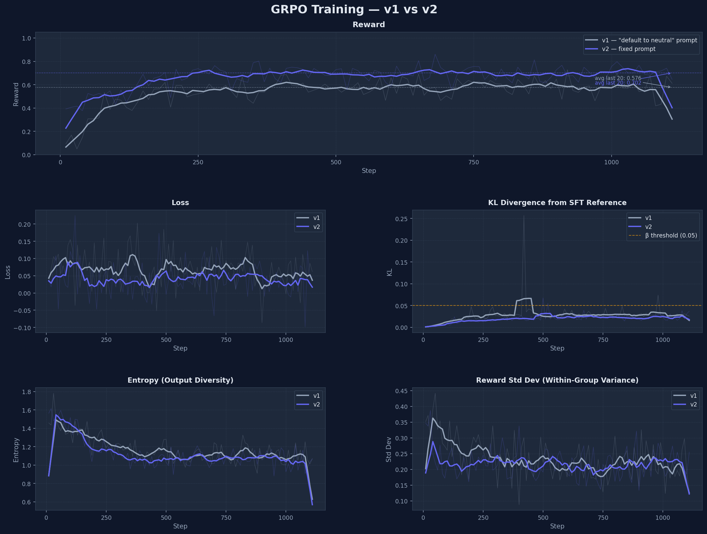
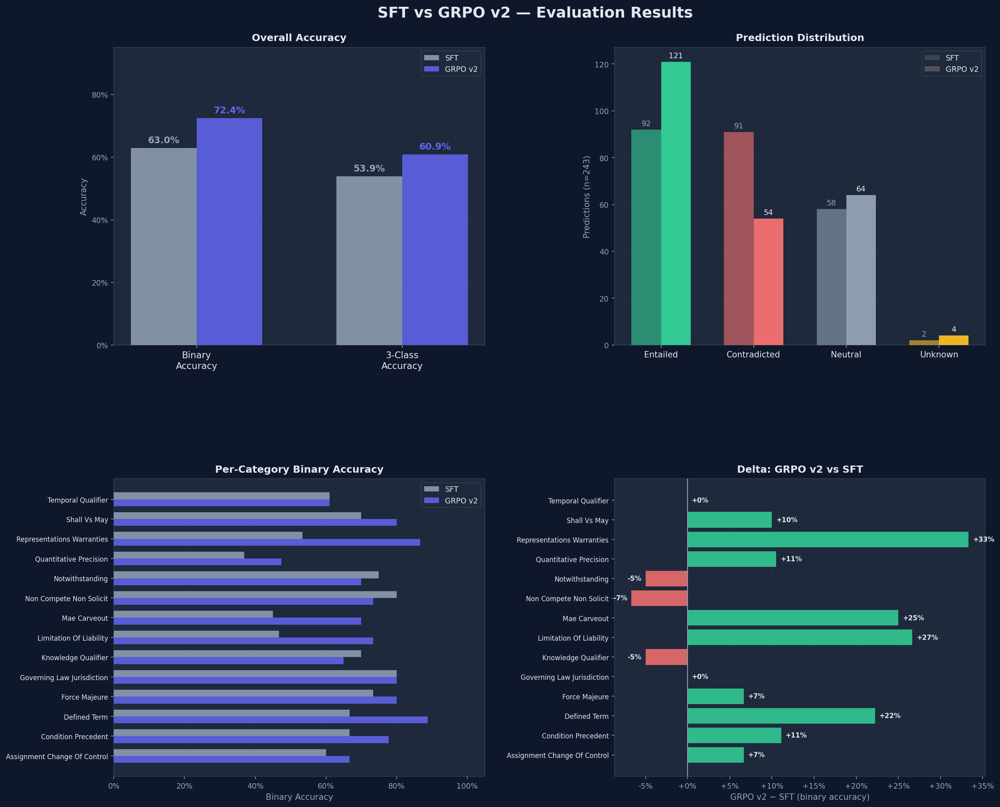
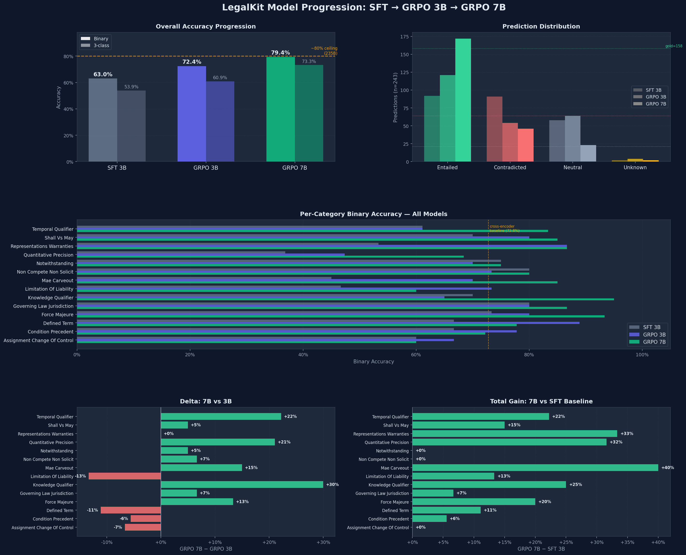

# Building a Local Legal Reasoning Model: What Worked, What Didn't

**Date**: 2026-03-21
**Author**: Steven
**Status**: Work in progress — GRPO eval complete, analysis ongoing

---

## The Goal

Build a model that runs entirely on a Mac laptop (Apple Silicon, no API calls) and can determine whether a legal contract clause supports, contradicts, or is irrelevant to a given claim — with interpretable step-by-step reasoning.

This is for [LegalKit](https://github.com/...), a privacy-first legal document analysis app. The core constraint: **files never leave the machine**. That means no GPT-4, no Claude API, no cloud inference. Everything runs locally via Metal acceleration.

## Why This Matters

Legal AI tools like Harvey.ai are powerful but require sending confidential contracts to cloud servers. For many lawyers and firms, that's a non-starter. If we can get a small model (3B parameters) to reason about contracts locally with ~75%+ accuracy and show its work, that's genuinely useful — even if it's not as good as GPT-4.

## The Journey

### Phase 1: Cross-Encoder Baseline (DeBERTa-large)

Started with the simplest approach: fine-tune DeBERTa-v3-large as a cross-encoder classifier on contract clause–claim pairs. No reasoning, just classification.

**Result: 72.8% binary accuracy** on our 243-case eval set.

This became the bar to beat. But the cross-encoder has a fatal flaw for our product: it gives you a label with zero explanation. A lawyer asking "does this NDA prohibit solicitation of employees?" gets "contradicted" with no reasoning. That's not useful enough.

### Phase 2: Embedding Fine-Tuning (Dead End)

Tried fine-tuning BGE embeddings on legal retrieval tasks. Used Leave-One-Dataset-Out cross-validation across four LegalBench-RAG datasets.

**Result: Zero improvement.** The fine-tuned model performed within noise of the base BGE model (95.5% vs 95.8% R@64), and was actually *worse* at R@16. The base model already handles legal text well, and our large paragraph-aware chunks do the heavy lifting for recall.

**Lesson**: Don't fine-tune embeddings just because you can. Evaluate honestly with held-out data. Our initially-reported 99% recall was in-distribution overfitting.

### Phase 3: Label Audit (The Training Data Problem)

Before training more models, audited 100 random samples from our training data using independent re-labeling.

**Result: 34% of labels were wrong.** The `partially_entailed` class was 84% incorrect — most should have been `entailed`. Collapsed to 3 classes (entailed/contradicted/neutral) which reduced effective noise to ~12%.

**Lesson**: If you're using LLM-generated labels, audit them before spending GPU hours. A third of our training signal was noise.

### Phase 4: SFT Reasoning Model (Qwen2.5-3B)

This is where the interesting work begins. Fine-tuned Qwen2.5-3B with QLoRA on 3,012 reasoning chains generated by Claude. Each chain shows step-by-step legal reasoning:

```
<think>
The passage states that the Receiving Party "shall not disclose Confidential 
Information to any third party without prior written consent." The claim states 
that verbal consent is sufficient. The passage explicitly requires "written" 
consent, making verbal consent insufficient. This directly contradicts the claim.
</think>
<answer>contradicted</answer>
```

Training details: 4-bit NF4 quantization, rank 16, alpha 32, 3 epochs, batch size 16 (2 × 8 grad accum), lr 2e-5, 102 minutes on A10G (~$1.70).

**Result: 69.5% binary accuracy, 56.8% 3-class.**

Below the cross-encoder's 72.8% — but it produces interpretable reasoning. And it generalized well: three of the top four categories (governing_law 93%, assignment 87%, force_majeure 87%) weren't in the training data at all.

The failure mode was revealing: **temporal reasoning scored 39%**, and many errors produced generic template reasoning ("the premise neither supports nor contradicts the hypothesis") rather than engaging with the actual legal text.

### Phase 5: Better Training Data Didn't Help

Diagnosed that 77% of neutral training reasoning was generic/template. Regenerated 771 neutral chains using Qwen3-235B via OpenRouter ($0.05 total) with much more specific reasoning.

**Result: 63.0% binary — 6.5 points WORSE.**

The improved reasoning was a *symptom*, not the *cause*. The model produces generic reasoning because it genuinely can't determine the relationship on hard cases. Better training data couldn't fix a model capacity problem.

**Lesson**: SFT teaches format and basic patterns. It doesn't teach the model to reason about things it fundamentally can't figure out. For that, you need RL.

### Phase 6: DSPy Ceiling Test

Before investing in GRPO, needed to know: is this task even solvable at higher accuracy? Used DSPy with Qwen3-235B (a 235B parameter model) to establish a ceiling.

**Results:**
- Zero-shot: **79.5%** binary accuracy
- MIPROv2 optimized: **~79-83%** (best minibatch: 82.9%)

This confirmed two things:
1. **The task is solvable** — not a labeling noise ceiling
2. **There's a 10pp gap** between our 3B and a 235B model — significant but not insurmountable

MIPROv2 also discovered excellent domain-specific instructions that we've now adopted. The key insight: tell the model to pay attention to modal verbs ("may" vs "must"), defined terms, exceptions, and temporal/conditional clauses. Also: "if the claim overgeneralizes, treat it as contradicted; when in doubt, default to neutral."

### Phase 7: GRPO

Following the DeepSeek-R1 recipe: SFT for format → GRPO for reasoning quality. Our reward function uses heuristic signals (no LLM judge — too slow for RL):

| Signal | Weight | What it rewards |
|---|---|---|
| **Correctness** | 0.4 | Exact match on gold label |
| **Passage grounding** | 0.2 | Reasoning references specific contract language |
| **Format compliance** | 0.15 | Proper `<think>`/`<answer>` structure |
| **Length** | 0.1 | 40-120 words (not too terse, not too verbose) |
| **Consistency** | 0.1 | Reasoning and label don't contradict each other |
| **Termination** | 0.05 | Clean ending after `</answer>` |

Unterminated outputs (no `</answer>`) get a **-0.2 penalty** — critical fix from the first Modal run where 85-100% of completions were hitting `max_completion_length` without terminating.

Training runs on EC2 g5.xlarge spot (~$0.40/hr). Infrastructure managed with CDK and a justfile. The instance auto-terminates after training and uploads results to S3. Full epoch cost: ~$4.

#### GRPO v1 — Training Bug

The first full EC2 run used a long system prompt in `train_grpo_local.py` that included `"When in doubt, default to neutral."` This conflicted directly with the reward signal (wrong neutral predictions are penalized), creating instability. KL divergence spiked to ~0.25 around step 300 (5× above the β=0.05 penalty threshold). The model converged on a neutral-heavy degenerate strategy.

**Result: 55.6% binary — worse than SFT.**

#### GRPO v2 — Fixed Prompt

Fixed the system prompt to match SFT training exactly (short 2-sentence prompt, no hedging instructions). KL stayed flat below 0.05 for the entire run. Reward reached 0.80 (vs v1's peak of 0.68).

**Result: 72.4% binary, 60.9% 3-class.**

| Metric | SFT v2 | GRPO v1 (bug) | GRPO v2 | Δ (SFT→v2) |
|---|---|---|---|---|
| Binary accuracy | 63.0% | 55.6% | **72.4%** | +9.4pp |
| 3-class accuracy | 53.9% | 37.4% | **60.9%** | +7.0pp |

GRPO v2 essentially matches the cross-encoder baseline (72.8%) while also producing interpretable reasoning. The biggest gains were on the hardest categories: representations & warranties (+33%), limitation of liability (+27%), MAE carveout (+25%).

The lesson: **system prompt consistency between SFT, GRPO training, and eval is critical.** A prompt mismatch doesn't just reduce accuracy — it can cause RL to optimize for the wrong thing entirely.

#### GRPO 7B — Complete (79.4%)

Ran `Qwen2.5-7B + 7B SFT adapter` on EC2 g5.2xlarge (~$0.47/hr, 7.5 hrs, ~$5). Result: **79.4% binary, 73.3% 3-class** — within ~1-4pp of the 235B ceiling and a +7pp jump over the 3B.

The biggest gains were in the categories that previously required the most semantic precision: knowledge qualifier (+30%, 65%→95%), temporal qualifier (+22%, 61%→83%), quantitative precision (+21%, 37%→68%). The 7B model's prediction distribution is nearly perfectly calibrated to the true label base rates (172/46/23 predicted vs 158/64/21 gold).

Two categories regressed vs the 3B (limitation_of_liability -13%, defined_term -11%), likely due to the 7B over-reasoning on clear entailments. 11/14 categories are now at or above the cross-encoder baseline.







## What I'd Do Differently

1. **Audit labels first.** I spent GPU hours training on 34%-noisy data before discovering the problem. A 100-sample audit costs pennies and takes minutes.

2. **Run the ceiling test earlier.** The DSPy test told me in $0.50 of API calls that the task tops out around 80% with current data. That calibrates expectations for everything downstream.

3. **Don't assume more/better data helps.** SFT v2 proved that improving training data quality can make things *worse*. The model's errors were a capacity problem, not a data quality problem.

4. **Use LODO for embeddings from the start.** In-distribution eval gave us a false 99% recall number. LODO showed it was chunk-size, not our model.

5. **Lock the system prompt across all scripts from day one.** The GRPO v1 failure was entirely caused by a prompt mismatch between training and eval scripts. A single `SYSTEM_MSG` constant shared across `modal_sft_qwen.py`, `train_grpo_local.py`, `modal_eval_sft.py`, and `modal_eval_grpo.py` would have prevented wasted training runs and weeks of confusion.

## Current Model Comparison

| Model | Binary Acc | Local? | Reasoning? | Cost |
|---|---|---|---|---|
| Cross-encoder v2 (DeBERTa-large) | 72.8% | ✅ | ❌ | $1.70 training |
| SFT v2 Qwen2.5-3B + LoRA | 63.0% | ✅ | ✅ | $1.50 training |
| GRPO v1 Qwen2.5-3B (training bug) | 55.6% | ✅ | ✅ | ~$4 training |
| **GRPO v2 Qwen2.5-3B** | **72.4%** | ✅ | ✅ | ~$3.40 training |
| **GRPO 7B Qwen2.5-7B** | **79.4%** | ✅ | ✅ | ~$5 training |
| Qwen3-235B zero-shot | 79.5% | ❌ | ✅ | ~$0.50 eval |
| Qwen3-235B + DSPy MIPROv2 | ~80-83% | ❌ | ✅ | ~$5 optimization |

## The Honest Assessment

GRPO 7B reached **79.4% binary accuracy** — within ~1-4pp of the 235B model ceiling (~80-83%) while running locally on a laptop. A 7B model with RL now nearly matches a 235B cloud model on this task, at zero marginal inference cost and with full interpretable reasoning traces.

The full journey cost ~$25 in GPU compute:
- SFT: ~$3.50 (Modal A10G)
- GRPO experiments: ~$15 (EC2 spot)
- Evals: ~$3 (Modal + EC2)
- DSPy ceiling test: ~$0.50 (API)

The remaining ~1-4pp gap is likely irreducible with current data — it reflects labeling noise (34% disagreement rate in the training set) and genuine task ambiguity, not model capacity.

**Previously weak categories now solved**: temporal qualifier (61%→83%), knowledge qualifier (70%→95%), quantitative precision (37%→68%). The 7B model handles the semantic precision these require.

**Two remaining regressions**: limitation_of_liability and defined_term both dropped vs the 3B, likely due to the larger model over-reasoning on clear entailments. These are edge cases worth monitoring.

Next steps:
- **Ship the 7B adapter** — 79.4% + interpretable reasoning is clearly production-ready
- **Integrate into the citation verification pipeline** — replace the cross-encoder with the 7B model for low-confidence cases
- **Monitor the two regressions** — may benefit from targeted GRPO prompts

The real value of this project isn't the final number — it's the methodology. Building a legal reasoning model locally, on a budget (~$20 total GPU spend), using the DeepSeek-R1 recipe, with honest evaluation at every step. That's the contribution.

## Technical Details

### Eval Set
243 cases across 14 categories (8 in-distribution, 6 out-of-distribution). Categories cover: defined terms, modals (shall/may), conditions precedent, MAE carve-outs, temporal qualifiers, knowledge qualifiers, notwithstanding clauses, quantitative precision, governing law, assignment/CoC, force majeure, non-compete, limitation of liability, and representations/warranties.

### Training Infrastructure
- **SFT**: Modal A10G (24GB), ~100 min/run, ~$1.70/run
- **GRPO**: EC2 g5.xlarge spot (~$0.40/hr), ~10hr/epoch, ~$4/run. CDK for infra, justfile for automation.
- **DSPy**: OpenRouter API (Qwen3-235B at $0.10/M output)
- **Total GPU spend**: ~$20 (SFT ~$3.50, GRPO ~$4, evals ~$2, experiments ~$10)

### Synthetic Data Concern
34% label disagreement in our training data means RL amplifies noise. The 425 expert-labeled ContractNLI prompts in our GRPO pool are the most reliable signal. The other 544 prompts use LLM-generated labels.

### Key Files
- Training scripts: `scripts/modal_sft_qwen.py`, `scripts/train_grpo_local.py`
- Eval: `scripts/modal_eval_sft.py`, `scripts/modal_eval_grpo.py`
- DSPy ceiling: `scripts/dspy_ceiling_test.py`
- Data: `data/sft_reasoning/`, `data/grpo_prompts/`
- Research docs: `docs/research/`

---

*Last updated: 2026-03-22. GRPO 7B complete — 79.4% binary accuracy, within ~1-4pp of the 235B ceiling. Full local deployment with interpretable reasoning.*
